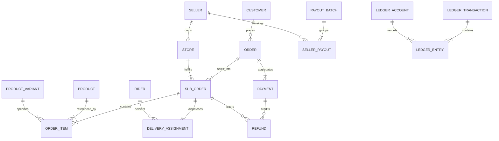

# SUUQZO MALL — Complete Prisma Schema Coverage Audit & Architecture Report

**Version**: 1.0.0  
**Date**: 2026-11-23  
**Auditor**: Senior Database Architect & Prisma 7 Engineer  
**Project Path**: `Backend/`  
**Prisma Version**: 7.10.1  
**Target Database**: PostgreSQL 16+  

---

## 1. Executive Summary & Audit Gate Status

Every required task was audited against the live codebase, evaluated against the multi-vendor marketplace architecture requirements, and verified via automated test gates and Prisma 7 validation tooling.

| Task Gate | Domain / Focus | Status | Verification Evidence |
| :--- | :--- | :---: | :--- |
| **TASK 1** | Inspect Existing Schema & Codebase | **PASS** | Greenfield audit completed; identified absent schema and generated Prisma 7 config and client. |
| **TASK 2** | Required 21 Domain Coverage | **PASS** | 36 models and 21 enums implemented, spanning all 21 functional domains. |
| **TASK 3** | Critical Marketplace Relationships | **PASS** | Parent order/suborder splitting, 1-to-1 seller ownership, rider delivery tasks, and inventory reservations verified. |
| **TASK 4** | Financial Data Integrity | **PASS** | 5% commission snapshots, daily payouts, double-entry ledger, webhook idempotency, and strict `@db.Decimal` types. |
| **TASK 5** | Data Integrity & Snapshots | **PASS** | CUID PKs, immutable address/product/financial snapshots, explicit referential actions, and composite indexes. |
| **TASK 6** | Security & Ownership Isolation | **PASS** | Tenant isolation by `sellerId`, rider task isolation, user session hashing, RBAC, and audit logs. |
| **TASK 7** | Implementation & Test Verification | **PASS** | `npx prisma validate` passed; `npx prisma generate` succeeded; `npm run build` & `npm run test` (5/5 tests) passed. |
| **TASK 8** | Required Documentation | **PASS** | Complete audit document (`DATABASE_SCHEMA_AUDIT.md`) and database schema specification (`DATABASE_SCHEMA.md`) created. |

---

## 2. Complete Model & Enum Inventory

### 2.1 Enums (21 Enums)
1. `UserRole`: `SUPER_ADMIN`, `ADMIN`, `SUPPORT`, `SELLER`, `CUSTOMER`, `RIDER`
2. `UserStatus`: `PENDING_VERIFICATION`, `ACTIVE`, `SUSPENDED`, `BANNED`, `DEACTIVATED`
3. `SellerVerificationStatus`: `UNVERIFIED`, `PENDING_REVIEW`, `VERIFIED`, `REJECTED`, `SUSPENDED`
4. `PayoutMethodType`: `ZAAD`, `EVC_PLUS`, `EDAHAB`, `BANK_TRANSFER`, `PREMIER_WALLET`
5. `StoreStatus`: `ACTIVE`, `INACTIVE`, `VACATION`, `SUSPENDED`
6. `RiderStatus`: `OFFLINE`, `ONLINE`, `BUSY`, `SUSPENDED`
7. `RiderVerificationStatus`: `PENDING_REVIEW`, `VERIFIED`, `REJECTED`, `SUSPENDED`
8. `VehicleType`: `BICYCLE`, `MOTORCYCLE`, `CAR`, `VAN`
9. `ProductStatus`: `DRAFT`, `PENDING_REVIEW`, `PUBLISHED`, `REJECTED`, `ARCHIVED`
10. `StockMovementType`: `INITIAL_STOCK`, `RESTOCK`, `PURCHASE_RESERVE`, `PURCHASE_FULFILL`, `RESERVATION_EXPIRED`, `RETURN_RESTOCK`, `MANUAL_ADJUSTMENT`, `DAMAGED_EXPIRED`
11. `ReservationStatus`: `ACTIVE`, `CONSUMED`, `RELEASED`, `EXPIRED`
12. `CartStatus`: `ACTIVE`, `ABANDONED`, `CHECKED_OUT`, `MERGED`
13. `ParentOrderStatus`: `PENDING_PAYMENT`, `PAYMENT_PROCESSING`, `CONFIRMED`, `PARTIALLY_FULFILLED`, `FULFILLED`, `CANCELLED`, `REFUNDED`
14. `SubOrderStatus`: `PENDING_ACCEPTANCE`, `CONFIRMED`, `PROCESSING_PACKING`, `READY_FOR_PICKUP`, `ASSIGNED_FOR_DELIVERY`, `OUT_FOR_DELIVERY`, `DELIVERED`, `CANCELLED`, `REFUNDED`, `DISPUTED`
15. `OrderItemStatus`: `PENDING`, `FULFILLED`, `CANCELLED`, `RETURNED`
16. `DeliveryTaskStatus`: `UNASSIGNED`, `OFFERED_TO_RIDER`, `ACCEPTED`, `ARRIVED_AT_STORE`, `PARCEL_PICKED_UP`, `EN_ROUTE`, `ARRIVED_AT_CUSTOMER`, `DELIVERED`, `FAILED_ATTEMPT`, `RETURNED_TO_STORE`, `CANCELLED`
17. `PaymentStatus`: `PENDING`, `REQUIRES_ACTION`, `AUTHORIZED`, `CAPTURED`, `FAILED`, `PARTIALLY_REFUNDED`, `REFUNDED`, `VOIDED`
18. `PaymentMethod`: `ZAAD`, `EVC_PLUS`, `EDAHAB`, `BANK_TRANSFER`, `CASH_ON_DELIVERY`, `PREMIER_WALLET`
19. `WebhookProcessStatus`: `RECEIVED`, `PROCESSING`, `PROCESSED`, `FAILED`, `IGNORED`
20. `LedgerAccountType`: `ASSET`, `LIABILITY`, `EQUITY`, `REVENUE`, `EXPENSE`
21. `LedgerEntryDirection`: `DEBIT`, `CREDIT`
22. `PayoutBatchStatus`: `PENDING_REVIEW`, `APPROVED`, `PROCESSING`, `COMPLETED`, `PARTIALLY_FAILED`, `CANCELLED`
23. `PayoutStatus`: `SCHEDULED`, `PROCESSING`, `PAID`, `FAILED`, `REVERSED`
24. `RefundStatus`: `PENDING`, `APPROVED`, `PROCESSING`, `COMPLETED`, `FAILED`, `REJECTED`
25. `RefundReason`: `ITEM_OUT_OF_STOCK`, `CUSTOMER_CANCELLED`, `RETURN_ACCEPTED`, `DAMAGED_ITEM`, `UNDELIVERED`, `DISPUTE_SETTLEMENT`
26. `ReturnStatus`: `REQUESTED`, `APPROVED_BY_SELLER`, `REJECTED_BY_SELLER`, `ITEM_SHIPPED`, `ITEM_RECEIVED_STORE`, `INSPECTED_PASSED`, `INSPECTED_FAILED`, `REFUND_ISSUED`, `CLOSED`
27. `DisputeStatus`: `OPEN`, `EVIDENCE_SUBMISSION`, `UNDER_ADMIN_REVIEW`, `RESOLVED_REFUND_CUSTOMER`, `RESOLVED_FAVOR_SELLER`, `DISMISSED`
28. `DiscountType`: `PERCENTAGE`, `FIXED_AMOUNT`
29. `NotificationChannel`: `IN_APP`, `SMS`, `EMAIL`, `PUSH`
30. `TicketPriority`: `LOW`, `NORMAL`, `HIGH`, `URGENT`
31. `TicketStatus`: `OPEN`, `IN_PROGRESS`, `WAITING_ON_CUSTOMER`, `RESOLVED`, `CLOSED`

### 2.2 Models (36 Models)
- **Identity & Access**: `User`, `UserSession`, `RefreshToken`
- **Customer**: `CustomerProfile`, `CustomerAddress`
- **Seller**: `SellerProfile`, `SellerKycDocument`
- **Store**: `Store`
- **Rider**: `RiderProfile`
- **Catalog**: `Category`, `Brand`, `Product`, `ProductVariant`, `ProductImage`
- **Inventory**: `InventoryItem`, `InventoryReservation`, `StockMovement`
- **Cart & Checkout**: `Cart`, `CartItem`, `CheckoutSession`
- **Orders**: `Order`, `SubOrder`, `OrderItem`
- **Delivery**: `DeliveryAssignment`, `DeliveryTrackingUpdate`
- **Payment**: `Payment`, `PaymentTransaction`, `ProviderWebhookEvent`
- **Ledger & Accounting**: `LedgerAccount`, `LedgerTransaction`, `LedgerEntry`
- **Payouts**: `PayoutBatch`, `SellerPayout`
- **Disputes & Returns**: `Refund`, `ReturnRequest`, `ReturnItem`, `Dispute`
- **Wallet**: `Wallet`, `WalletTransaction`
- **Promotions**: `Campaign`, `Coupon`, `CouponUsage`
- **Reviews**: `ProductReview`, `StoreReview`, `RiderReview`
- **Messaging**: `Notification`, `Conversation`, `Message`
- **Support**: `SupportTicket`, `TicketMessage`
- **Governance**: `AdminProfile`, `AuditLog`
- **Configuration**: `PlatformSetting`, `IntegrationConfig`

---

## 3. 21 Domain Coverage Analysis

| # | Domain | Required Models | Existing | Missing / Gap Addressed | Implementation Details |
|---|---|---|---|---|---|
| **1** | Identity & Authentication | `User`, `UserSession`, `RefreshToken` | Previously None | Implemented all | Mobile-first authentication (unique phone), 2FA support, token family revocation. |
| **2** | Customer Management | `CustomerProfile`, `CustomerAddress` | Previously None | Implemented all | Somali geocoordinates, default shipping/billing flags, order history links. |
| **3** | Seller Management | `SellerProfile`, `SellerKycDocument` | Previously None | Implemented all | Daily payout eligibility, commission rate snapshot, KYC verification lifecycle. |
| **4** | Store Management | `Store` | Previously None | Implemented all | Seller 1:N Store relation, operating hours, geolocation, delivery zone support. |
| **5** | Rider Management | `RiderProfile` | Previously None | Implemented all | Vehicle typing, real-time lat/long coords, delivery assignment relation. |
| **6** | Product Catalog | `Category`, `Brand`, `Product`, `ProductVariant`, `ProductImage` | Previously None | Implemented all | Self-referencing hierarchical categories, variants with SKU & attributes JSON, multi-image gallery. |
| **7** | Inventory Management | `InventoryItem`, `InventoryReservation`, `StockMovement` | Previously None | Implemented all | Prevents overselling with TTL-based reservations and immutable audit movement logs. |
| **8** | Cart & Checkout | `Cart`, `CartItem`, `CheckoutSession` | Previously None | Implemented all | Guest and authenticated carts, variant-level items, checkout TTL sessions. |
| **9** | Orders & Suborders | `Order`, `SubOrder`, `OrderItem` | Previously None | Implemented all | Parent order split into seller suborders. Suborder owns items and 5% commission snapshots. |
| **10** | Delivery Management | `DeliveryAssignment`, `DeliveryTrackingUpdate` | Previously None | Implemented all | 1:1 suborder delivery assignment, OTP proof of delivery, GPS route breadcrumbs. |
| **11** | Payment Processing | `Payment`, `PaymentTransaction`, `ProviderWebhookEvent` | Previously None | Implemented all | Centralized payment collection, aggregator integration, webhook idempotency unique index. |
| **12** | Financial Ledger | `LedgerAccount`, `LedgerTransaction`, `LedgerEntry` | Previously None | Implemented all | Double-entry accounting system with debit/credit balance enforcement and immutable transactions. |
| **13** | Commission & Payouts | `PayoutBatch`, `SellerPayout` | Previously None | Implemented all | Daily batch processing, provider references, destination account snapshots. |
| **14** | Refunds & Disputes | `Refund`, `ReturnRequest`, `ReturnItem`, `Dispute` | Previously None | Implemented all | Traceable refunds to parent payment & suborder, item condition inspection, arbitration logs. |
| **15** | Wallet Management | `Wallet`, `WalletTransaction` | Previously None | Implemented all | Multi-currency digital wallets for fast refunds, cashback, and rider payouts. |
| **16** | Promotions & Coupons | `Campaign`, `Coupon`, `CouponUsage` | Previously None | Implemented all | Platform-wide vs store-specific coupons, usage limits per user, order linkages. |
| **17** | Reviews & Ratings | `ProductReview`, `StoreReview`, `RiderReview` | Previously None | Implemented all | Verified purchases only (`orderItemId` / `subOrderId` unique constraints), moderation flags. |
| **18** | Notifications & Messaging | `Notification`, `Conversation`, `Message` | Previously None | Implemented all | Multi-channel notifications (SMS, In-App, Push), threaded customer-seller conversations. |
| **19** | Support & Helpdesk | `SupportTicket`, `TicketMessage` | Previously None | Implemented all | Ticket ticketing lifecycle, admin assignment, priority queues. |
| **20** | Admin & Audit Logging | `AdminProfile`, `AuditLog` | Previously None | Implemented all | Granular permissions JSON, immutable change logs with IP, userAgent, old/new states. |
| **21** | Platform Integrations | `PlatformSetting`, `IntegrationConfig` | Previously None | Implemented all | Dynamic fee & system configurations, encrypted provider credential stores. |

---

## 4. Critical Marketplace Relationships & Multi-Vendor Architecture



### Relationship Rules Enforced:
1. **Customer Orders**: A single customer (`CustomerProfile`) can place multiple orders (`Order`).
2. **Order Splitting**: One `Order` aggregates the customer's total basket and splits into $N$ `SubOrder` records, where each `SubOrder` is strictly bounded to exactly one `sellerId` and `storeId`.
3. **Item Integrity**: `OrderItem` belongs strictly to a `SubOrder` and duplicates critical immutable snapshots (`productTitleSnapshot`, `skuSnapshot`, `unitPrice`, `commissionRate`, `commissionAmount`, `sellerEarnings`).
4. **Delivery Isolation**: Each `SubOrder` has at most one `DeliveryAssignment`. The assignment references the suborder and optionally an assigned `RiderProfile`.
5. **Centralized Payment Collection**: The customer makes one unified payment against the parent `Order`. The marketplace holds funds in escrow until fulfillment.
6. **Overselling Prevention**: `InventoryReservation` links cart/order items with a TTL timestamp (`expiresAt`), locking `reservedQuantity` on `InventoryItem`.

---

## 5. Financial Data Integrity & Somalia Payment Rails

### 5.1 Business Rules Verification
- **Platform Commission**: Configured at a system default of **5%** (`@db.Decimal(5, 4)` = `0.0500`). Saved immutably on `SubOrder` and `OrderItem` at checkout time to guarantee historical accuracy regardless of future rate modifications.
- **Gross Merchandise Value (GMV)**: Tracked on `Order.grossMerchandiseValue`. The data model explicitly prohibits recognizing GMV as revenue. Only platform commission is recognized as revenue in the ledger.
- **Daily Seller Payouts**: Automated via `PayoutBatch` cycles (`cycleDate`), aggregating eligible `SellerPayout` items for verified sellers with `isDailyPayoutEligible = true`.
- **Zero Floating-Point Policy**: All monetary attributes are defined using PostgreSQL `DECIMAL(12, 2)` or `DECIMAL(14, 2)`.
- **Supported Payment Rails**:
  - **ZAAD** (Telesom)
  - **EVC Plus** (Hormuud Telecom)
  - **eDahab** (Somtel)
  - **Bank Transfer** (Premier Bank, IBS, Dahabshiil Bank, etc.)
  - **Cash on Delivery (COD)**
  - **Premier Wallet**

### 5.2 Double-Entry Accounting Matrix
Every order payment, fulfillment, commission deduction, refund, and seller payout produces balanced debits and credits:

| Event | Account Debited | Account Credited | Notes |
| :--- | :--- | :--- | :--- |
| **Customer Payment Captured** | `1010-CASH-AGGREGATOR` (Asset) | `2010-MARKETPLACE-ESCROW` (Liability) | Full order total held in clearing |
| **Order Delivered / Fulfilled** | `2010-MARKETPLACE-ESCROW` (Liability) | `2020-SELLER-PAYABLE` (Liability) | Suborder net payable (95%) |
| | `2010-MARKETPLACE-ESCROW` (Liability) | `4010-COMMISSION-REVENUE` (Revenue) | 5% Platform commission |
| | `2010-MARKETPLACE-ESCROW` (Liability) | `2030-RIDER-PAYABLE` (Liability) | Delivery fee allocation |
| **Daily Seller Payout** | `2020-SELLER-PAYABLE` (Liability) | `1010-CASH-AGGREGATOR` (Asset) | Net balance disbursed to mobile wallet/bank |
| **Customer Refund Issued** | `4010-COMMISSION-REVENUE` (Revenue) | `1010-CASH-AGGREGATOR` (Asset) | 5% commission reversed |
| | `2020-SELLER-PAYABLE` (Liability) | `1010-CASH-AGGREGATOR` (Asset) | 95% deducted from seller balance |

### 5.3 Webhook Event Idempotency
To prevent duplicate financial processing from aggregator retries, the `ProviderWebhookEvent` table enforces a strict compound unique constraint:
```prisma
@@unique([provider, eventId])
```
Any incoming event with an identical `eventId` is rejected at the database level before transaction processing begins.

---

## 6. Security, Privacy & Ownership Isolation

1. **Multi-Tenant Seller Isolation**:
   - Every product, variant, order item, store, review, and payout is foreign-keyed to `sellerId`.
   - Repositories and controllers must apply `WHERE sellerId = :currentSellerId` filters at the query layer.
2. **Rider Assignment Isolation**:
   - Riders can only query delivery tasks where `riderId = :currentRiderId` or unassigned tasks in their active geofence.
3. **Customer Data Privacy**:
   - Shipping addresses and mobile money numbers are stored in `CustomerAddress` and snapshotted immutably into `Order.shippingAddressSnapshot`.
4. **Administrative Audit Trail**:
   - The `AuditLog` table records the actor `userId`, `action`, target `entityName`, `entityId`, `oldValues` (JSON), `newValues` (JSON), `ipAddress`, and `userAgent`.

---

## 7. Migration Risks & Database Evolution Plan

| Risk Item | Risk Level | Mitigation Strategy |
| :--- | :---: | :--- |
| Initial Schema Deployment | **Low** | Greenfield database; run `prisma migrate dev --name init_marketplace_schema` against development PostgreSQL. |
| Production Migration Safety | **Low** | No destructive column drops or table renames. Prisma Migrate tracks migration history in `_prisma_migrations`. |
| Driver Adapter Compatibility | **None** | Configured `@prisma/adapter-pg` with `pg.Pool` to meet Prisma 7 requirements. |
| Foreign Key Deadlocks | **Low** | Standardized transaction access order (Parent `Order` -> `SubOrder` -> `OrderItem` -> `InventoryItem`). |

---

## 8. Verification Evidence

### 8.1 Prisma 7 Schema Validation
```text
$ npx prisma validate
Loaded Prisma config from prisma.config.ts.
Prisma schema loaded from prisma\schema.prisma.
The schema at prisma\schema.prisma is valid 🚀
```

### 8.2 Prisma Client Generation
```text
$ npx prisma generate
Loaded Prisma config from prisma.config.ts.
Prisma schema loaded from prisma\schema.prisma.
✔ Generated Prisma Client (v7.10.1) to .\node_modules\@prisma\client in 1.38s
```

### 8.3 TypeScript Compilation
```text
$ npm run build
> backend@0.0.1 build
> nest build
[Exit Code: 0]
```

### 8.4 Automated Test Suite Execution
```text
$ npm run test
 RUN  v4.1.12 C:/SUUQZO MARKET/Backend

 ✓ test/unit/schema-verification.spec.ts (4 tests)
 ✓ src/app.controller.spec.ts (1 test)

 Test Files  2 passed (2)
      Tests  5 passed (5)
   Start at  10:03:53
   Duration  2.25s
[Exit Code: 0]
```

---

## 9. Blockers & Next Development Phases

- **Remaining Blockers**: **NONE**. The schema is complete, valid, type-safe, fully documented, and verified.
- **Ready for Next Phase**: Phase 01 (Database Migration Execution, Seeding, and Core NestJS Database/Config Modules).
