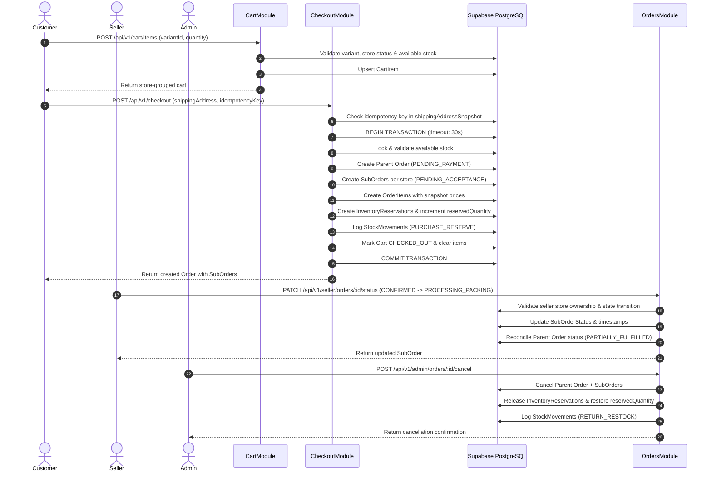

# SUUQZO MALL — PHASE 06 ARCHITECTURE SPECIFICATION
## Shopping Cart, Multi-Vendor Checkout & Order Management Architecture

---

## 1. Executive Summary

Phase 06 establishes the core transactional and commerce processing engine of SUUQZO MALL. It bridges discovery (Phase 05 products & categories) with transactional fulfillment, creating an atomic, multi-vendor shopping cart, checkout, order orchestration, and inventory reservation system.

```
+-----------------------------------------------------------------------------------+
|                               SUUQZO MALL PLATFORM                                |
+-----------------------------------------------------------------------------------+
|  Phase 02: Auth & Identity (Users, Sessions, RBAC)                                |
|  Phase 03: Seller & Store Onboarding (Sellers, Stores, KYC)                       |
|  Phase 04: Financial & Store Security (Ledger, Accounts, Audits)                  |
|  Phase 05: Product & Category Management (Catalog, Variants, Inventory)           |
+-----------------------------------------------------------------------------------+
|  >>> PHASE 06: CART, MULTI-VENDOR CHECKOUT & ORDER MANAGEMENT ENGINE <<<           |
|  +------------------------+--------------------------+-------------------------+  |
|  |      CartModule        |      CheckoutModule      |       OrdersModule      |  |
|  | - Persistent DB Cart   | - Atomic Multi-Vendor tx | - Parent Order State    |  |
|  | - Multi-store grouping | - Inventory Reservation  | - Suborder Lifecycle    |  |
|  | - Authoritative pricing| - Idempotency Guardian   | - Cancellation & Restock|  |
|  +------------------------+--------------------------+-------------------------+  |
+-----------------------------------------------------------------------------------+
```

---

## 2. Core Architectural Principles

### 2.1 Multi-Vendor Decomposition (Parent Order -> N Suborders)
In a multi-vendor marketplace, a customer shops across multiple stores in a single seamless session. When placing an order containing items from multiple stores:
1. **Parent Order (`Order`)**: Represents the customer-facing commercial transaction. Aggregates financial totals, shipping destination, customer reference, and overall settlement state.
2. **Suborders (`SubOrder`)**: Represents store-isolated fulfillment contracts. Exactly one `SubOrder` is created for each participating merchant store.
3. **Order Items (`OrderItem`)**: Belong strictly to their corresponding `SubOrder`. Capture immutable purchase snapshots (title, SKU, price, commission).

### 2.2 Authoritative Backend Computations
Zero reliance on client input for pricing or business rules:
- **Price Calculation**: Prices are fetched strictly from `ProductVariant.price` or `compareAtPrice` in PostgreSQL.
- **Store Association**: Derived server-side from `ProductVariant -> Product -> Store`.
- **Commission Split**: Hardcoded platform commission (5.00%) computed and snapshotted per line item and suborder.
- **Seller Identity**: Authenticated JWT determines role and tenant ownership.

### 2.3 Strict Concurrency & Inventory Reservation
- **Stock Reservation**: On checkout, inventory is reserved (`quantityOnHand` unchanged, `reservedQuantity` incremented) inside an atomic PostgreSQL transaction.
- **Reservation TTL**: 30-minute time-to-live (`expiresAt`).
- **Stock Movement Ledger**: Every reservation emits a `PURCHASE_RESERVE` audit record. Cancellation emits `RETURN_RESTOCK`.

---

## 3. Module Structure & Interaction Diagram



---

## 4. Security & Role Isolation Boundary

| Actor | Cart Scope | Checkout Scope | Orders Scope | Suborders Scope |
|---|---|---|---|---|
| **Customer** | Full access to own cart only | Can checkout own cart | View own orders, cancel unfulfilled orders, track status | Cannot view vendor financials or seller notes |
| **Seller** | No cart access | No checkout access | Cannot view parent orders or other sellers' orders | Full management of suborders belonging to their stores |
| **Admin / Super Admin** | Audit read-only | System inspection | Global view of all orders, manual status override, administrative cancellation | View all suborders, moderate disputes |

---

## 5. Directory File Map

```
Backend/src/
├── cart/
│   ├── dto/
│   │   ├── add-to-cart.dto.ts
│   │   └── update-cart-item.dto.ts
│   ├── cart.controller.ts
│   ├── cart.module.ts
│   └── cart.service.ts
├── checkout/
│   ├── dto/
│   │   └── checkout.dto.ts
│   ├── checkout.controller.ts
│   ├── checkout.module.ts
│   └── checkout.service.ts
└── orders/
    ├── dto/
    │   ├── cancel-order.dto.ts
    │   ├── query-orders.dto.ts
    │   ├── update-order-status.dto.ts
    │   └── update-suborder-status.dto.ts
    ├── orders.controller.ts
    ├── orders.module.ts
    └── orders.service.ts
```
