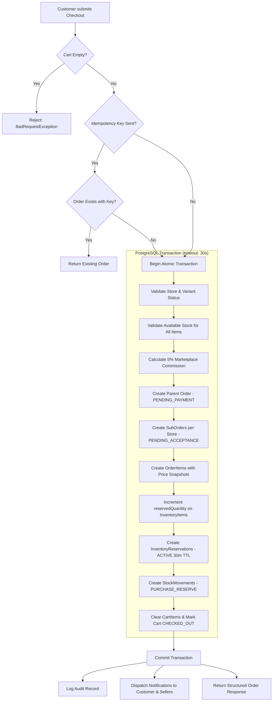

# SUUQZO MALL — PHASE 06 MULTI-VENDOR CHECKOUT WORKFLOW SPECIFICATION

---

## 1. Overview

The checkout service transforms a multi-vendor customer cart into an atomic set of fulfillment orders inside a single ACID PostgreSQL transaction.

---

## 2. Multi-Vendor Checkout Sequence

---

## 3. Financial Splits & Snapshots

For each `SubOrder`:
- **`itemsSubtotal`**: Sum of (`unitPrice * quantity`) for all items from this store.
- **`commissionRate`**: Platform default `0.0500` (5.00%).
- **`commissionAmount`**: `itemsSubtotal * 0.0500` rounded to 2 decimal places.
- **`sellerPayableAmount`**: `itemsSubtotal - commissionAmount`.

Each `OrderItem` snapshots:
- `productTitleSnapshot`
- `variantTitleSnapshot`
- `skuSnapshot`
- `unitPrice` (authoritative variant price at checkout)
- `quantity`
- `totalPrice` (`unitPrice * quantity`)
- `commissionRate` (0.0500)
- `commissionAmount`
- `sellerEarnings`

These values remain completely immutable even if products or store pricing are subsequently altered.
