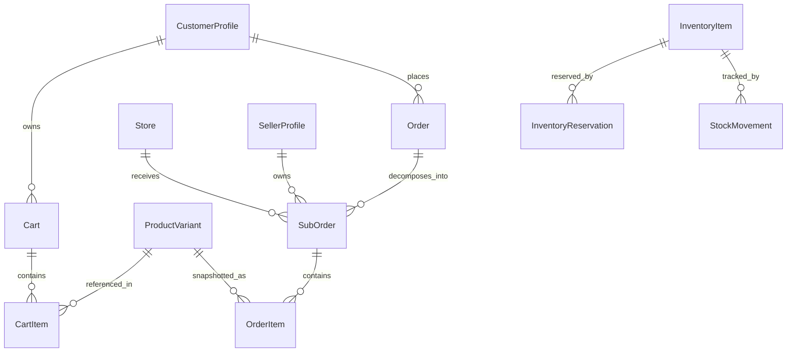

# SUUQZO MALL — PHASE 06 DATABASE SCHEMA SPECIFICATION

---

## 1. Schema Overview

Phase 06 reuses and operates against the pre-existing, production-grade Prisma schema models without introducing schema drift or breaking changes.

### Key Entity Relationship Diagram



---

## 2. Model Reference

### 2.1 Cart & CartItem
```prisma
model Cart {
  id               String            @id @default(cuid())
  customerId       String?
  anonymousToken   String?           @unique
  status           CartStatus        @default(ACTIVE)
  currency         String            @default("USD")
  createdAt        DateTime          @default(now())
  updatedAt        DateTime          @updatedAt

  customer         CustomerProfile?  @relation(fields: [customerId], references: [id], onDelete: Cascade)
  items            CartItem[]
  checkoutSessions CheckoutSession[]

  @@index([customerId, status])
}

model CartItem {
  id        String         @id @default(cuid())
  cartId    String
  variantId String
  quantity  Int            @default(1)
  unitPrice Decimal        @db.Decimal(12, 2)
  createdAt DateTime       @default(now())
  updatedAt DateTime       @updatedAt

  cart      Cart           @relation(fields: [cartId], references: [id], onDelete: Cascade)
  variant   ProductVariant @relation(fields: [variantId], references: [id], onDelete: Cascade)

  @@unique([cartId, variantId])
}
```

### 2.2 Order (Parent Order)
```prisma
model Order {
  id                      String            @id @default(cuid())
  orderNumber             String            @unique
  customerId              String
  status                  ParentOrderStatus @default(PENDING_PAYMENT)
  grossMerchandiseValue   Decimal           @db.Decimal(12, 2)
  subtotalAmount          Decimal           @db.Decimal(12, 2)
  deliveryFeeAmount       Decimal           @db.Decimal(12, 2)
  taxAmount               Decimal           @default(0.00) @db.Decimal(12, 2)
  discountAmount          Decimal           @default(0.00) @db.Decimal(12, 2)
  totalPayable            Decimal           @db.Decimal(12, 2)
  currency                String            @default("USD")
  shippingAddressSnapshot Json
  createdAt               DateTime          @default(now())
  updatedAt               DateTime          @updatedAt

  customer                CustomerProfile   @relation(fields: [customerId], references: [id], onDelete: Restrict)
  subOrders               SubOrder[]
  payments                Payment[]
  refunds                 Refund[]
  disputes                Dispute[]
  couponUsages            CouponUsage[]

  @@index([customerId, status])
  @@index([orderNumber])
  @@index([createdAt])
}
```

### 2.3 SubOrder (Vendor Suborder)
```prisma
model SubOrder {
  id                  String         @id @default(cuid())
  subOrderNumber      String         @unique
  parentOrderId       String
  sellerId            String
  storeId             String
  status              SubOrderStatus @default(PENDING_ACCEPTANCE)
  itemsSubtotal       Decimal        @db.Decimal(12, 2)
  deliveryFee         Decimal        @default(0.00) @db.Decimal(10, 2)
  discountAmount      Decimal        @default(0.00) @db.Decimal(10, 2)
  totalAmount         Decimal        @db.Decimal(12, 2)
  commissionRate      Decimal        @default(0.0500) @db.Decimal(5, 4)
  commissionAmount    Decimal        @db.Decimal(12, 2)
  sellerPayableAmount Decimal        @db.Decimal(12, 2)
  customerNotes       String?        @db.Text
  sellerNotes         String?        @db.Text
  confirmedAt         DateTime?
  packedAt            DateTime?
  shippedAt           DateTime?
  deliveredAt         DateTime?
  cancelledAt         DateTime?
  cancellationReason  String?
  createdAt           DateTime       @default(now())
  updatedAt           DateTime       @updatedAt

  parentOrder         Order          @relation(fields: [parentOrderId], references: [id], onDelete: Cascade)
  seller              SellerProfile  @relation(fields: [sellerId], references: [id], onDelete: Restrict)
  store               Store          @relation(fields: [storeId], references: [id], onDelete: Restrict)
  items               OrderItem[]
  deliveryAssignment  DeliveryAssignment?
  storeReview         StoreReview?

  @@index([parentOrderId])
  @@index([sellerId])
  @@index([storeId])
  @@index([status])
}
```

### 2.4 OrderItem (Immutable Snapshot)
```prisma
model OrderItem {
  id                   String          @id @default(cuid())
  subOrderId           String
  sellerId             String
  productId            String
  variantId            String
  status               OrderItemStatus @default(PENDING)
  productTitleSnapshot String
  variantTitleSnapshot String?
  skuSnapshot          String
  unitPrice            Decimal         @db.Decimal(12, 2)
  quantity             Int
  totalPrice           Decimal         @db.Decimal(12, 2)
  commissionRate       Decimal         @db.Decimal(5, 4)
  commissionAmount     Decimal         @db.Decimal(12, 2)
  sellerEarnings       Decimal         @db.Decimal(12, 2)
  createdAt            DateTime        @default(now())
  updatedAt            DateTime        @updatedAt

  subOrder             SubOrder        @relation(fields: [subOrderId], references: [id], onDelete: Restrict)
  seller               SellerProfile   @relation(fields: [sellerId], references: [id], onDelete: Restrict)
  product              Product         @relation(fields: [productId], references: [id], onDelete: Restrict)
  variant              ProductVariant  @relation(fields: [variantId], references: [id], onDelete: Restrict)
}
```

### 2.5 InventoryReservation
```prisma
model InventoryReservation {
  id              String            @id @default(cuid())
  inventoryItemId String
  variantId       String
  cartId          String?
  orderId         String?
  subOrderId      String?
  quantity        Int
  status          ReservationStatus @default(ACTIVE)
  expiresAt       DateTime
  releasedAt      DateTime?
  createdAt       DateTime          @default(now())
  updatedAt       DateTime          @updatedAt

  inventoryItem   InventoryItem     @relation(fields: [inventoryItemId], references: [id], onDelete: Cascade)
  variant         ProductVariant    @relation(fields: [variantId], references: [id], onDelete: Cascade)

  @@index([inventoryItemId, status])
  @@index([orderId])
  @@index([expiresAt])
}
```

---

## 3. Idempotency Key Storage Design

To respect database stability and avoid destructive schema updates, idempotency keys are stored in the `shippingAddressSnapshot` JSON structure:

```json
{
  "recipientName": "Omar Hassan",
  "phone": "+252616000000",
  "street": "Airport Road",
  "city": "Mogadishu",
  "district": "Waberi",
  "idempotencyKey": "idemp-customer-tx-12345",
  "customerNotes": "Deliver after 2 PM"
}
```

Lookup uses customer-scoped index retrieval and in-memory key matching (`take: 10, orderBy: { createdAt: 'desc' }`) combined with an intra-transaction JSON path verification:
```ts
where: {
  customerId: customer.id,
  shippingAddressSnapshot: { path: ['idempotencyKey'], equals: effectiveIdempotencyKey }
}
```
This guarantees duplicate protection without adding non-indexed database locks.
