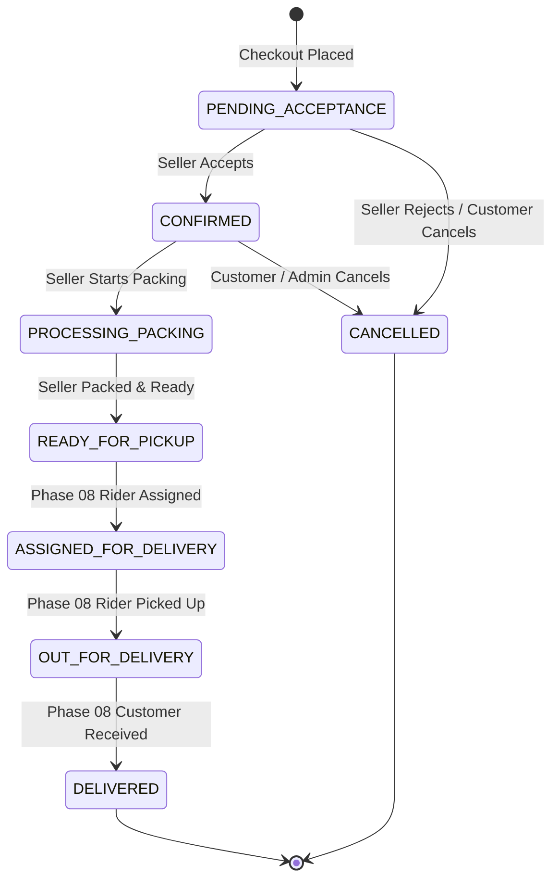
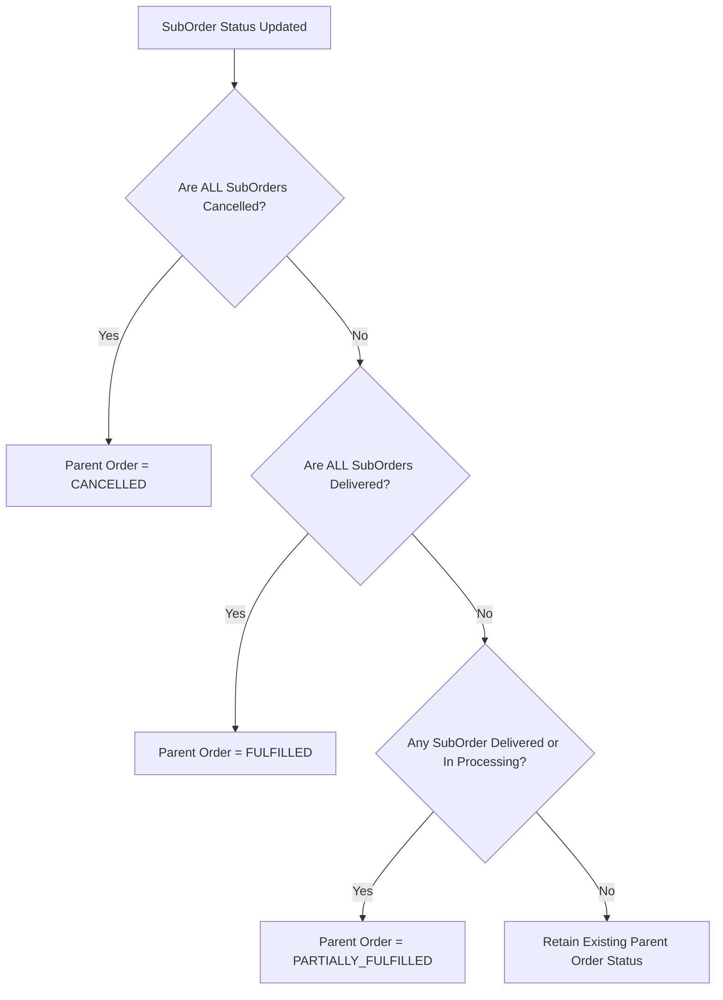

# SUUQZO MALL — PHASE 06 ORDER LIFECYCLE & STATE RECONCILIATION

---

## 1. SubOrder State Lifecycle

Each `SubOrder` progresses through well-defined operational states:

### Transition Validation Rules (Seller Actions):
- **PENDING_ACCEPTANCE**: May transition to `CONFIRMED` or `CANCELLED`.
- **CONFIRMED**: May transition to `PROCESSING_PACKING` or `CANCELLED`.
- **PROCESSING_PACKING**: May transition to `READY_FOR_PICKUP`.
- **READY_FOR_PICKUP**: Handed off to logistics (Phase 08).
- **Direct jumps (e.g. `PENDING_ACCEPTANCE -> DELIVERED`)**: Strictly forbidden with `BadRequestException`.

---

## 2. Parent Order State Reconciliation

The `ParentOrderStatus` dynamically reflects the aggregate progress of its suborders:

### Reconciliation Rules:
1. If **all** suborders reach `CANCELLED`, parent order moves to `CANCELLED`.
2. If **all** suborders reach `DELIVERED`, parent order moves to `FULFILLED`.
3. If **any** suborder is `DELIVERED`, `OUT_FOR_DELIVERY`, `READY_FOR_PICKUP`, or `PROCESSING_PACKING`, parent order transitions to `PARTIALLY_FULFILLED`.

---

## 3. Order Cancellation Logic

### Customer Cancellation
- Allowed only when order is in `PENDING_PAYMENT` or all suborders are in `PENDING_ACCEPTANCE` or `CONFIRMED`.
- Once any suborder enters `PROCESSING_PACKING`, customer cancellation is **blocked** to protect merchant inventory and preparation costs.

### Cancellation Effects:
1. Parent order status set to `CANCELLED`.
2. All active suborders set to `CANCELLED`.
3. Associated `InventoryReservation` records set to `RELEASED`.
4. `reservedQuantity` on `InventoryItem` decremented by the cancelled quantity.
5. `StockMovement` logged with `type: RETURN_RESTOCK`.
