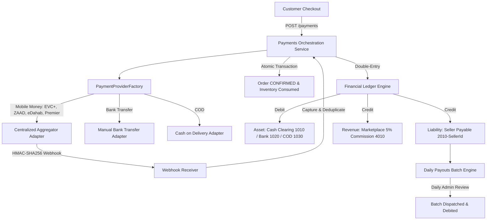

# SUUQZO MALL — PHASE 07 ARCHITECTURE
## Centralized Payment Provider, Financial Ledger, Seller Payouts & Reconciliation

**Document Version:** 1.0.0  
**Phase:** 07  
**Module:** Payments & Finance  
**Framework:** NestJS 11 (ESM)  
**Database:** Supabase PostgreSQL (Prisma 7)  

---

## 1. System Overview & Core Principles

SUUQZO MALL implements a **centralized marketplace payment model** for multi-vendor checkout. Customer payments are collected centrally by the SUUQZO platform, platform commission (5%) is retained, and net seller earnings are credited to dedicated liability ledger accounts for scheduled daily payouts.

### Key Architectural Tenets:
1. **Separation of Concerns:** Orders are not payments. Order status and payment status maintain independent lifecycles.
2. **Provider Abstraction:** All payment methods implement the common `IPaymentProvider` contract.
3. **Strict Double-Entry Accounting:** No money moves without matching Debits and Credits (`Total Debits === Total Credits`). All entries are immutable.
4. **Idempotency & Deduplication:** Webhooks and payment requests are protected against double-posting and replay attacks.
5. **Exact Decimal Arithmetic:** All financial calculations strictly utilize `Prisma.Decimal` to eliminate floating-point drift.

---

## 2. Component Structure

- **`PaymentsService` (`src/payments/payments.service.ts`):** Orchestrates payment sessions, webhook processing, manual verifications, and order transitions.
- **`FinancialLedgerService` (`src/payments/financial-ledger.service.ts`):** Manages the chart of accounts, enforces double-entry verification, and records ledger transactions.
- **`RefundsService` (`src/payments/refunds.service.ts`):** Processes partial and full customer refunds, debiting seller liability and reversing commission revenue.
- **`SellerPayoutsService` (`src/payments/seller-payouts.service.ts`):** Generates daily payout batches for eligible sellers and executes ledger settlements upon admin approval.
- **`PaymentProviderFactory` (`src/payments/payment-provider.factory.ts`):** Dynamically resolves payment provider adapters based on payment method.
- **Adapters (`src/payments/providers/`):**
  - `AggregatorPaymentAdapter`: EVC Plus, ZAAD, eDahab, Premier Wallet.
  - `BankTransferPaymentAdapter`: Bank settlement with manual verification.
  - `CashOnDeliveryPaymentAdapter`: Physical cash collection.
