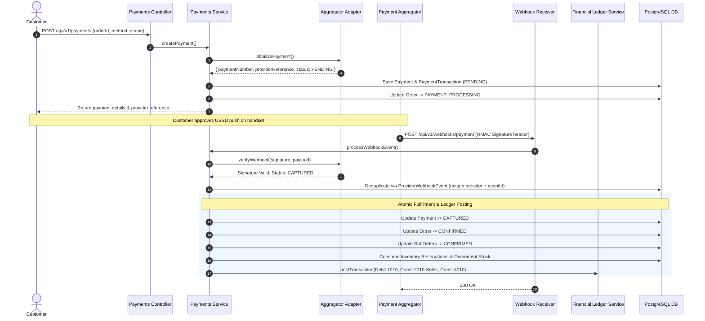

# SUUQZO MALL — PHASE 07 PAYMENT WORKFLOWS
## End-to-End Payment Lifecycles Across All Supported Methods

---

## 1. Mobile Money via Aggregator (EVC Plus, ZAAD, eDahab, Premier Wallet)

---

## 2. Bank Transfer Payment Workflow

1. **Customer Request:** Customer selects `BANK_TRANSFER`.
2. **Instruction Generation:** System returns bank account numbers (Premier Bank, Dahabshiil Bank) and a unique payment reference `SQ-BT-XXXXXX`. Payment remains `PENDING`.
3. **Customer Transfer:** Customer transfers funds using external bank app or teller, citing `SQ-BT-XXXXXX` in transfer remarks.
4. **Admin Audit & Verification:** Finance admin inspects bank statement and executes `POST /api/v1/admin/payments/:id/verify-bank-transfer` with `bankReference`.
5. **Execution:**
   - Payment status becomes `CAPTURED`.
   - Order transitions to `CONFIRMED`.
   - Active inventory reservations transition to `CONSUMED`.
   - Ledger posts:
     - `Debit: 1020 Bank Transfer Settlement Account`
     - `Credit: 2010-{sellerId} Seller Payable`
     - `Credit: 4010 Marketplace Commission Revenue`

---

## 3. Cash on Delivery (COD) Workflow

1. **Customer Request:** Customer selects `CASH_ON_DELIVERY`. Payment status set to `PENDING`.
2. **Order Confirmation:** Order is confirmed for dispatch. Inventory is reserved.
3. **Physical Delivery:** Rider / courier delivers physical parcel to recipient.
4. **Cash Collection:** Recipient pays physical cash. Authorized delivery personnel / admin triggers `POST /api/v1/admin/payments/:id/confirm-cod`.
5. **Execution:**
   - Payment status becomes `CAPTURED`.
   - Ledger posts:
     - `Debit: 1030 Cash on Delivery Receivable`
     - `Credit: 2010-{sellerId} Seller Payable`
     - `Credit: 4010 Marketplace Commission Revenue`
