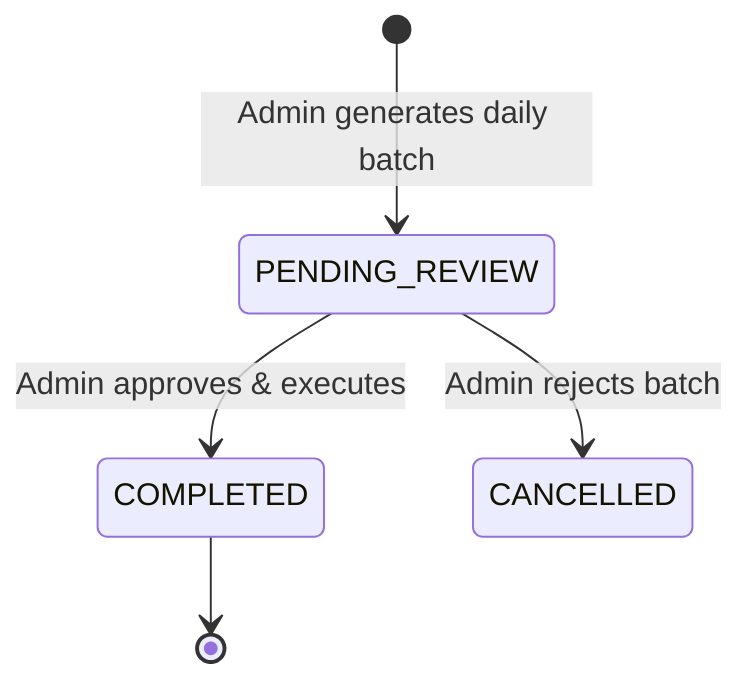

# SUUQZO MALL — PHASE 07 SELLER PAYOUT WORKFLOW
## Daily Batch Generation, Approval Cycle & Ledger Settlement

---

## 1. Payout Lifecycle

### Stages:
1. **Batch Generation (`POST /api/v1/admin/payouts/generate`):**
   - Discovers all sellers with `isDailyPayoutEligible: true`.
   - Checks `availableBalance` for each seller via `FinancialLedgerService`.
   - For sellers with `availableBalance > 0`, creates `SellerPayout` records with status `SCHEDULED`.
   - Creates parent `PayoutBatch` with status `PENDING_REVIEW`.

2. **Admin Review & Approval (`POST /api/v1/admin/payouts/:batchId/approve`):**
   - Requires `ADMIN_PAYOUTS_APPROVE` permission.
   - Updates `PayoutBatch.status` to `COMPLETED`.
   - For each payout:
     - Updates status to `PAID`.
     - Posts double-entry ledger debit to seller liability account `2010-{sellerId}` and credit to `1010 Cash Clearing`.
     - Dispatches in-app notification to merchant.
     - Logs audit trail entry with executing admin ID.
